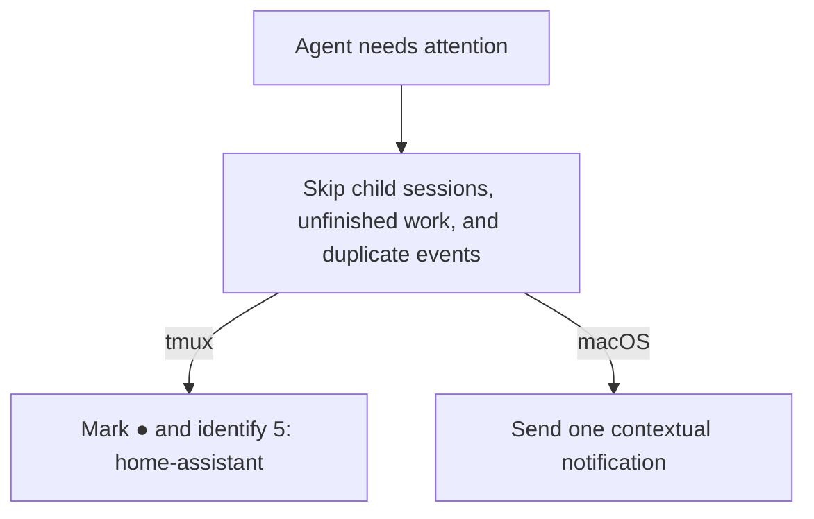

# Agent Contextual Notifier

Get a useful alert when a coding agent needs your attention, without being notified for every
session event.

Supported agents:

- [OpenCode](#2-opencode)
- [Claude Code](#3-claude-code)

## What it does



Notifications can include the agent, project, session title, latest prompt, latest result, and the
originating tmux window. The notifier handles:

- completed work;
- questions and permission requests;
- plans ready for review;
- session errors.

In tmux, the originating window keeps a `●` marker until you return to it. Every agent uses the same
marker, so one tmux setup covers all of them. Without tmux, macOS notifications continue without
the window label or marker. The notifier sends no telemetry.

## Requirements

- macOS for Notification Center delivery.
- Optional: tmux 3.2 or newer for attention markers.
- Optional: TPM for the easiest tmux companion installation.
- OpenCode: the community plugin API (`plugin` in `opencode.json`).
- Claude Code: plugin support and [Bun](https://bun.sh) on your `PATH`, which runs the hook.

## Install

### 1. Add the tmux companion (optional)

Add the plugin before the TPM loader at the bottom of `~/.tmux.conf`:

```tmux
set -g @plugin "shmileee/agent-contextual-notifier"

run "~/.tmux/plugins/tpm/tpm"
```

Press `prefix` + <kbd>I</kbd> to install it. The companion:

- adds the waiting marker to current and non-current window formats once;
- preserves existing window formats and hooks;
- clears the marker when you select the window or focus the tmux client.

Without TPM, clone the repository and source the entrypoint directly:

```tmux
run-shell "/absolute/path/agent-contextual-notifier/agent-contextual-notifier.tmux"
```

Reload the tmux configuration after installation. You do not need to restart the tmux server.

### 2. OpenCode

Add the npm package to `~/.config/opencode/opencode.json`:

```json
{
  "$schema": "https://opencode.ai/config.json",
  "plugin": ["agent-contextual-notifier"]
}
```

OpenCode installs npm plugins with Bun on the next startup. Quit and restart every running
OpenCode process after changing the configuration.

Oh My OpenAgent includes its own session notification hook. To avoid duplicate notifications,
disable it in your active `oh-my-openagent.json[c]` or `oh-my-opencode.json[c]` configuration and
restart OpenCode:

```json
{
  "disabled_hooks": ["session-notification"]
}
```

### 3. Claude Code

Install the plugin from this repository, which is also its own marketplace:

```
/plugin install agent-contextual-notifier --marketplace shmileee/agent-contextual-notifier
```

On Claude Code versions before 2.1.275, add the marketplace first:

```
/plugin marketplace add shmileee/agent-contextual-notifier
/plugin install agent-contextual-notifier@agent-contextual-notifier
```

Restart running Claude Code sessions afterwards. The plugin registers hooks only; it adds no
commands, skills, or MCP servers.

## Customize

### Notification sound

The default sound is `Submarine`.

In OpenCode, use the plugin tuple form to choose another macOS sound:

```json
{
  "$schema": "https://opencode.ai/config.json",
  "plugin": [["agent-contextual-notifier", { "sound": "Glass" }]]
}
```

In Claude Code, set the plugin's `sound` option, then restart Claude Code:

```bash
echo '{"sound": "Glass"}' |
  claude plugin configure agent-contextual-notifier@agent-contextual-notifier --values-stdin
```

### tmux marker

The default marker is `●`. Set `@agent-notifier-marker` before the TPM loader to change it:

```tmux
set -g @agent-notifier-marker "!"
```

To place the marker yourself, put `#{?@agent_waiting,#{@agent_waiting} ,}` in your
`window-status-format` and `window-status-current-format`. The companion leaves formats that
already contain it alone.

## How noise filtering works

OpenCode: before notifying for completed work, the plugin confirms that the session is ready for
input. It skips:

- child sessions;
- sessions with unfinished todos;
- active Oh My OpenAgent continuation work;
- duplicate idle events and repeated updates;
- stale events superseded by newer user activity;
- completion events whose readiness cannot be established safely.

Claude Code: the plugin follows the main session only. It skips:

- subagent completions;
- finished turns that still have background tasks running;
- permission prompts and questions you answer within a few seconds, because Claude Code announces
  them only after they have waited;
- idle reminders, which would repeat the completion notification.

## Migrating from opencode-contextual-notifier

This project was published as `opencode-contextual-notifier` before it supported more than one
agent.

- OpenCode: replace `opencode-contextual-notifier` with `agent-contextual-notifier` in the `plugin`
  list of `opencode.json`.
- tmux: change the TPM line to `shmileee/agent-contextual-notifier`, then press `prefix` +
  <kbd>I</kbd>. Existing `@opencode-notifier-marker` settings and `@opencode_waiting` segments in
  your window formats keep working: the companion reads the old marker option and rewrites the
  loaded formats and hooks to the new `@agent_waiting` name. Rename them in your configuration when
  convenient.

## Development

### Layout

- `src/core`: agent-neutral notification content, completion rules, and delivery to tmux and macOS.
- `src/opencode`: the OpenCode plugin, built to `dist/` and published to npm.
- `src/claude`: the Claude Code hook, run from source by Bun. It must stay free of npm
  dependencies, because Claude Code installs plugins by cloning the repository without a build.
- `.claude-plugin` and `hooks`: the Claude Code plugin manifest, marketplace entry, and hook
  registration.
- `scripts/agent-notifier-tmux` and `agent-contextual-notifier.tmux`: the tmux helper and TPM
  entrypoint shared by every agent.

A new agent needs an adapter that turns its events into `mark` and `notify` calls on the core.

### Run from source

```bash
git clone https://github.com/shmileee/agent-contextual-notifier.git
cd agent-contextual-notifier
bun install
bun run check
bun run build
```

Load the built OpenCode plugin with an absolute file URL while developing:

```json
{
  "$schema": "https://opencode.ai/config.json",
  "plugin": ["file:///absolute/path/agent-contextual-notifier/dist/index.mjs"]
}
```

Load the Claude Code plugin from the checkout for one session:

```bash
claude --plugin-dir /absolute/path/agent-contextual-notifier
```

### Validate the package

```bash
bun run check
bun run build
bun pm pack
claude plugin validate .
```

Tests use UUID-scoped tmux sockets and never touch the live tmux server. `bun run test:e2e` installs
the packed plugin into a real OpenCode inside a container.

## License

MIT
